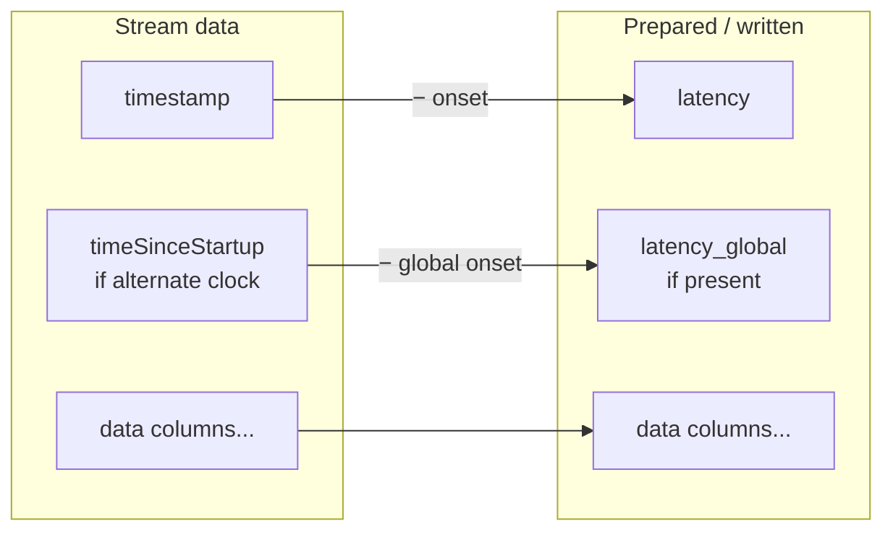

# Pipeline Stages

This page explains how a session moves through the pipeline, what data structure carries it, and what each of the six stages does. For the configuration knobs referenced here, see the [Configuration Reference](configuration.md).

## Orchestration

The entry point `run(config_path)` does the following:

1. Loads and checks the [config](configuration.md); a [configuration error](configuration.md#configuration-errors) stops the run here, before any session is read.
2. Builds a `BIDSLayout` rooted at `output.bids_root`.
3. Determines the sessions to process — from `session_mappings`, or by auto-discovery if none are given.
4. Processes each session through all six stages (below).
5. After all sessions, writes the **dataset-level files** (`dataset_description.json`, `participants.tsv`/`.json`, `README`, `.bidsignore`, and the derivative dataset description), if at least one session was processed. `participants.tsv` has one row per subject, from its first processed session, and lists only the subjects processed in this run; when `bids_root` holds `sub-*` folders it does not list (for example from an earlier run), a warning names them.
6. Logs the [run summary](cli.md#run-summary) and returns a [`RunResult`](api.md#run).

Each session is processed independently. If a session cannot be processed (any error, including an unexpected one), it is **logged and skipped** as `Failed to process <source_dir>: <reason>`, and processing continues with the next: one bad recording doesn't abort the batch.

### Skipped sessions

A skipped session leaves none of its files in the output. What the run had written for it (its `sourcedata/` copy, its raw and derivative session folders and its report) is removed, together with the `sub-*`, `sourcedata/`, `derivatives/resxr/` and `derivatives/` folders it created and left empty, and an info line names what was removed. Files marked read-only are removed too. A session folder or report that existed before the session started (a rerun into an existing output) is kept, with one warning each: that it may now hold partial files, or, when the session did not write into it, that it holds output of an earlier run. A kept folder that is, holds or lies inside a session's input folder (as when the session is read from its copy in `sourcedata/`, or when the output folders are the input folders) gets no warning when the session did not write into it, and otherwise a warning to remove the partial files, not the input. Nothing outside the BIDS root and `report.output_dir` is removed, nor anything that is, holds or lies inside a session's input folder, nor the data directory or a folder above it. A folder or report whose existence cannot be checked counts as existing, so it is kept, with a warning naming it; a folder that cannot be checked or removed during the cleanup also gives a warning, and the run continues. A session interrupted with `Ctrl-C` is cleaned up the same way before the run stops.

Before anything is written, a session is skipped with an error when one of its output folders lies inside a mapped session's input folder (its own or another's), or is or holds another mapped session's input folder, because writing there would mix or copy into that input: for example, reprocessing from `sourcedata/` with swapped subject labels, or a `bids_root` inside a session's own folder. The error names the output folder, the input folder and how they relate. A session's own input folder may itself be one of its output folders (reprocessing from its own `sourcedata/` copy).

### The Session object

Everything about one recording is carried by a `Session`. As the stages run, they populate it:

| Attribute | Set by | Holds |
| --------- | ------ | ----- |
| `metadata` | Load | Parsed `SessionMetadata` (timing, feature flags, software versions). |
| `raw_continuous_data`, `raw_face_data`, `raw_events_data` | Load | The source DataFrames. |
| `custom_tables`, `custom_tables_data` | Load | Custom-table schema and per-table DataFrames. |
| `streams` | Split | `dict[TrackingSystem, TrackingStream]` — the per-system data. |
| `motion_time_zero` | Split | The session's time zero: the first valid `timeSinceStartup` of the continuous data ([LATENCY channels](#latency-channels)). |
| `merged_events_data` | Validate | Events merged with custom tables. |
| `checks_not_run` | Validate | Enabled checks that produced no result for a stream, with the reason ([Checks not run](validation.md#checks-not-run)). |
| `subject_id`, `session_label` | Load | BIDS identifiers from the session mapping. |

Each `TrackingStream` holds the system's `data` (raw) and `clean_data` (post-masking), its `quality_flags`, expected/effective sampling frequencies, channel count, and computed stats. Useful derived properties include `duration_seconds`, `row_count`, `warning_count`/`error_count`, and `get_output_data()` (returns `clean_data` if present, else `data`).

---

## 1. Load

`load_session(session_dir, input_config)` reads the session folder:

- Locates each file by glob pattern (most-recent wins on multiple matches).
- Parses `SessionMetadata.json` (required) and the continuous CSV (required); renames the global clock `timeSinceStartup` → `timestamp`.
- Checks `timeSinceStartup` in the continuous and face files without changing it, and reports departures from the input contract (see [Input Data Format](input-data.md#checks-on-the-clocks)).
- Loads the optional face, events, and custom-table files; a bad face file is downgraded to a warning.

Right after loading, the session folder is copied verbatim into `sourcedata/` (an existing copy is kept unless [`output.overwrite`](configuration.md#output) is `true`).

The result is a `Session` populated with raw data and metadata. See [Input Data Format](input-data.md) for the file details.

---

## 2. Split

`split_continuous_data(...)` slices the single wide continuous DataFrame into one `TrackingStream` per enabled system, assigning columns by [prefix](input-data.md#how-columns-map-to-tracking-systems). A system is skipped if it's disabled in `systems`, disabled by the recording's metadata flags, or has no data columns. A system that has data but is not exported is reported with the reason (an info line when the config disables it or its metadata key is `false`; a warning when the key is missing or not `true`/`false`), and continuous-data columns that no stream takes are listed; they stay in `sourcedata/`. **Face** is built from the dedicated face file rather than the continuous data.

This stage is **split-only** — it selects columns and sets up the time axis, nothing more:

- If no [alternate time column](configuration.md#preprocessing) is configured for a system, its `timestamp` stays as the global clock.
- If one is configured, the alternate column becomes `timestamp` and the global clock is preserved as `timeSinceStartup`. The column is checked for milliseconds and backward steps (warnings; values unchanged). A configured column that the data do not have is a warning, and the stream keeps the global clock.

Each enabled system needs an entry in [`sampling_frequencies`](configuration.md#sampling_frequencies); `run` checks this at start-up, and this stage raises a `ConfigurationError` when it is called without one. The stream's *effective* rate is measured from the data at this point. A stream that cannot be timed (its clock is not numeric, has no non-zero value or fewer than two distinct values, or the stream has a single row) skips the session with an error, as does a session in which no enabled system has data columns.

!!! note "No time transforms here"
    LATENCY channels are **not** computed during splitting. That conversion happens at export time, in [`prepare_motion_data`](#latency-channels).

---

## 3. Validate

For each stream, the registry runs every enabled check and attaches the resulting `QualityFlag`s to `stream.quality_flags`. Checks may be per-stream or multi-stream (declaring `required_streams`). A check that throws is caught, logged as an error and recorded as [not run](validation.md#checks-not-run); it never aborts the run.

After validation, the session's events and custom tables are merged into `merged_events_data`, with onsets counted from the session's time zero (see [LATENCY channels](#latency-channels)).

Full details and the catalog of built-in checks: [Validation & Quality Checks](validation.md).

---

## 4. Preprocess

`preprocess_stream(stream, apply_masking, masking_checks)` produces each stream's `clean_data`:

- With `apply_quality_masking: false` (the default), `clean_data` is simply a copy of the raw data.
- With masking **on**, every flag marked maskable (optionally filtered to `masking_checks`) is applied: the flagged time ranges are set to `NaN`, either across the whole row or only in the flag's `target_columns`. **All rows are preserved**; the `timestamp` and `timeSinceStartup` columns are never masked. Integer/boolean columns are widened to nullable dtypes so they can hold `NaN`.

Masking only affects the **derivative** tier. The raw tier is written from the unmodified `data`.

---

## 5. Export BIDS

A session is written **twice**: once as RAW (from `stream.data`) and once as DERIVATIVE under `derivatives/resxr/` (from `stream.get_output_data()`). The original session folder was copied verbatim into `sourcedata/` after loading.

For each stream, just before writing, the data goes through `prepare_motion_data` (below). The resulting prepared DataFrame drives all three outputs for that system — `motion.tsv`, `channels.tsv`, and `motion.json` — so they always describe identical columns.

Also written: per-session `scans.tsv` (one row per motion file, with the recording's UTC acquisition time) and, on the raw tier, the merged `events.tsv`. See [BIDS Output](bids-output.md) for the complete file catalog.

### LATENCY channels

The recorder's internal time columns are never exported as-is. `prepare_motion_data(df, time_zero=session.motion_time_zero)` converts them into BIDS **LATENCY** channels:

- **`latency`**: `timestamp` minus an onset, inserted as the first column. For a stream with a per-system clock, the onset is that clock's first valid (finite, non-zero) value; for a stream timed by `timeSinceStartup` alone, it is the session's time zero (below).
- **`latency_global`**: present **only when** a per-system time column was used (so `timeSinceStartup` exists separately). It is `timeSinceStartup` minus the session's time zero, inserted right after `latency`.

The session's **time zero** is the first valid (finite, non-zero) `timeSinceStartup` of the continuous data file; the event onsets in `events.tsv` count from it too. A row whose clock value is zero or not finite (before the onset, after the last valid sample, or in between) is `n/a` in that channel. In a stream with a per-system clock, any other `*_Time` column (for example `Node_HandRight_Time` in Hands, whose clock is `Node_HandLeft_Time` in the shipped config) is converted to that clock's time base: the clock's onset is subtracted from it, and zero or non-finite values become `n/a`.

Both are reported in **seconds**. The original `timestamp` and `timeSinceStartup` columns are dropped from the output. This gives every BIDS file an onset-relative time axis, and `latency_global` (or `latency`, for a stream without its own clock) shares the session's time zero across files.

---

## 6. Report

If `report.enabled` is true, an interactive HTML report is generated per session at `<session_dir>/<session_id>_report.html`, or in `report.output_dir` when it is set. It summarizes the session, lists any checks that did not run, and shows per-stream statistics and a Plotly timeline of all quality flags, with flag times converted to a single onset-relative global timeline.

See [Quality Reports](reports.md).

---

## Raw vs. derivative tiers

| | RAW (`<bids_root>/`) | DERIVATIVE (`<bids_root>/derivatives/resxr/`) |
| --- | --- | --- |
| Source data | `stream.data` (unmodified) | `stream.get_output_data()` (masked if enabled) |
| Quality masking | never | applied when `apply_quality_masking: true` |
| `dataset_description.json` | `DatasetType: raw` | `DatasetType: derivative`, `GeneratedBy: ResXR` |
| Events files | yes (merged `events.tsv`) | no |
| LATENCY conversion | yes | yes |

The two tiers always contain the same set of tracking systems and the same column layout; they differ only in whether flagged samples have been masked.
